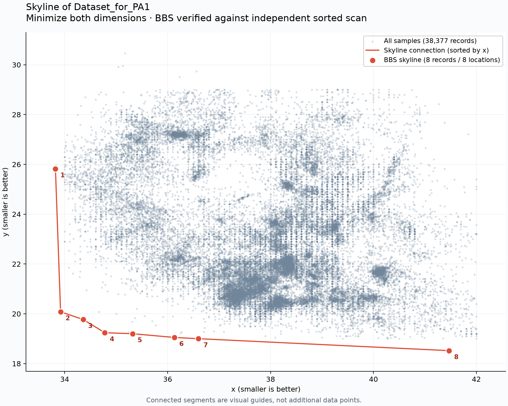

# R-tree Skyline Computation

A Python implementation of the Branch-and-Bound Skyline (BBS) algorithm that reads two-dimensional points, stores them in an R-tree, and returns the records that are not dominated by any other record.

Both dimensions are minimized: a point dominates another if it is no larger in either coordinate and strictly smaller in at least one coordinate; identical skyline points retain all their original records.

## 1. Project Structure

```text
skyline/
├── Dataset_for_PA1                 # Assignment dataset
├── skyline.py                      # Executable CLI
├── skyline_io.py                   # Shared input and verification
├── visualize_skyline.py             # Scatter plot and skyline connection
├── requirements-visualization.txt   # Optional plotting dependency
├── pyrtree/
│   ├── __init__.py
│   ├── rtree.py                     # R-tree storage and BBS
│   ├── rect.py                      # Rectangle geometry
│   ├── tests/
│   │   ├── test_cli.py
│   │   ├── test_points.py
│   │   ├── test_skyline.py
│   │   ├── test_rtree.py
│   │   ├── testutil.py
│   │   └── __init__.py
│   └── bench/                      # Original benchmark scripts
├── results/
│   ├── skyline.csv                 # Skyline records
│   └── skyline.png                 # Visualization
├── doc/ref/                        # Original R-tree reference
├── bin/                            # Original benchmark helpers
├── setup.py                        # Original package setup
├── .gitignore
└── README.md
```

## 2. New and Modified Program Files

| File | Status | Purpose |
|---|---|---|
| [pyrtree/rtree.py](pyrtree/rtree.py) | Modified | Fixes Python 3 and point-storage issues and implements `RTree.skyline()` with heap traversal, dominance pruning, and query statistics. |
| [skyline.py](skyline.py) | New | Provides the executable pipeline for parsing arguments, building the R-tree, computing and optionally verifying the skyline, and exporting CSV results. |
| [skyline_io.py](skyline_io.py) | New | Defines point records with original line IDs, validates dataset input, and provides an independent sorting-based skyline reference. |
| [visualize_skyline.py](visualize_skyline.py) | New | Plots all samples and the verified BBS skyline, highlighting and connecting distinct skyline locations in increasing x order. |


Supporting files: `requirements-visualization.txt` declares the optional Matplotlib dependency, and `.gitignore` excludes local environments and Python/Matplotlib caches.

## 3. How to Start

Run commands from the repository root using Python 3; the implementation has been tested with Python 3.13.

### Compute the Skyline

The core program uses only the Python standard library and the included `pyrtree` code.

```bash
python3 skyline.py Dataset_for_PA1 --output results/skyline.csv --verify
```

The executable form is equivalent:

```bash
./skyline.py Dataset_for_PA1 --output results/skyline.csv --verify
```

| Argument | Default | Description |
|---|---|---|
| `dataset` | Required | Path to a UTF-8 text file containing two finite numbers per nonblank line. |
| `--output PATH` | `results/skyline.csv` | Destination CSV file; missing parent directories are created. |
| `--seed INTEGER` | `42` | Random seed used by R-tree clustering for reproducible construction. |
| `--verify` | Disabled | Compares BBS record IDs with an independent sorted scan before writing the output. |

Input has no header, with coordinates separated by whitespace:

```text
38.90 23.90
39.75 25.25
38.50 22.25
```

Blank lines are skipped, while `record_id` preserves the original **one-based file line number**; malformed rows and non-finite coordinates produce an error with the offending line number.

CSV columns are `record_id,x,y`, ordered by `(x, y, record_id)`, with duplicate skyline records retained; an empty input produces a header-only CSV.

The terminal reports input and skyline counts, reading time, tree construction time, BBS query time, expanded nodes, and pruning counts; optional verification time is measured separately from BBS time.

A successful run replaces an existing output file only after the complete CSV has been written; input/output aliases are rejected, and invalid input or failed verification leaves existing output untouched.

Exit codes are `0` for success, `1` for input/output or verification failure, and `2` for invalid command-line arguments.

### Generate the Visualization

Install the optional plotting dependency in a local virtual environment:

```bash
python3 -m venv .venv
.venv/bin/python -m pip install -r requirements-visualization.txt
.venv/bin/python visualize_skyline.py Dataset_for_PA1 --output results/skyline.png
```

| Argument | Default | Description |
|---|---|---|
| `dataset` | `Dataset_for_PA1` | Input dataset path; unlike the computation CLI, this positional argument is optional. |
| `--output PATH` | `results/skyline.png` | Figure destination; use a `.pdf` extension to export PDF. |
| `--seed INTEGER` | `42` | Random seed used for R-tree construction. |

The plot always checks BBS against the independent reference before saving, prints numbered skyline coordinates, and rejects empty input because there are no samples to display.

## 4. Outcome

For `Dataset_for_PA1`, the program processed **38,377 records** representing **27,543 distinct coordinates** and returned **8 skyline records**, all at distinct coordinates; their record IDs matched the independent sorted-scan result exactly.

The full suite passed **34 tests**, both executable forms produced identical CSV files, and the visualization was regenerated successfully.

### Skyline Data

The following records are saved in [results/skyline.csv](results/skyline.csv); plot labels follow this table's row order.

| Plot label | Record ID (file line) | x | y |
|---|---:|---:|---:|
| 1 | 37348 | 33.82 | 25.82 |
| 2 | 36517 | 33.92 | 20.08 |
| 3 | 37192 | 34.36 | 19.77 |
| 4 | 36286 | 34.78 | 19.24 |
| 5 | 20959 | 35.32 | 19.20 |
| 6 | 33874 | 36.13 | 19.05 |
| 7 | 475 | 36.60 | 19.00 |
| 8 | 37297 | 41.47 | 18.52 |

With seed `42`, BBS expanded **41 internal nodes**, including the root, and pruned **82 entries before heap insertion** and **32 entries after heap removal**; these are in-memory traversal counts, not measured disk I/O.

### Visualization



Gray-blue markers show all input samples, while red markers identify skyline locations and labels correspond to the table above; the red segments connect locations in increasing x order as visual guides, not additional data points or a dominance-region boundary.

The R-tree is adapted from [pyrtree](https://code.google.com/archive/p/pyrtree/), and the BBS implementation follows Section 3.2 and Figure 3.4 of *Progressive Skyline Computation in Database Systems* by Papadias, Tao, Fu, and Seeger.
